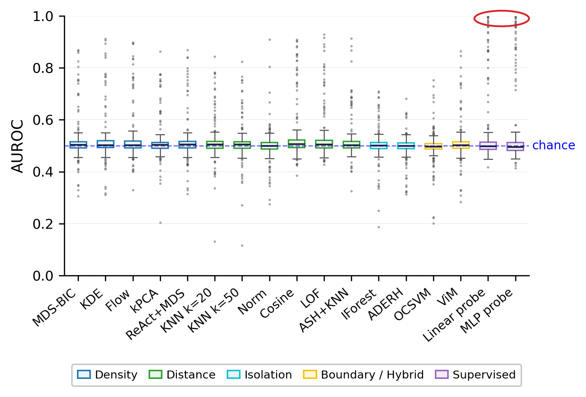
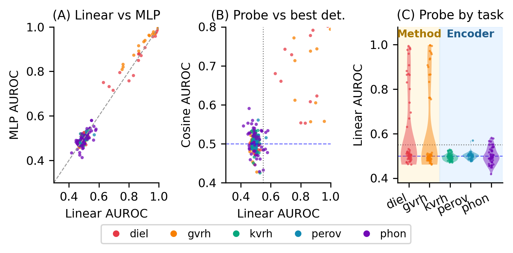

# MOOD: Benchmarking Post-Hoc OOD Detection for Materials Property Prediction

MOOD evaluates whether post-hoc out-of-distribution (OOD) detectors transfer from
vision to graph neural networks (GNNs) trained for materials property prediction.
It spans **5 MatBench tasks × 4 GNN architectures × 15 physically-motivated OOD
splits = 264 settings**, **15 unsupervised detectors + 2 supervised diagnostic
probes**, over **3 encoder training seeds (42, 123, 456)**. Reported numbers are
mean ± std across seeds (seven CGCNN/phonons settings collapse under seed 42 only
and are averaged over seeds 123 & 456).

- **Code:** <https://github.com/vertaix/mood-benchmark>
- **Data (embeddings, aggregated results):** <https://huggingface.co/datasets/shirlyu/mood-benchmark>

<p align="center">
  
</p>

**Figure 2.** AUROC of every detector across the 264 settings: unsupervised post-hoc detectors sit at chance,
and only the supervised probes (purple) occasionally reach near-perfect separation.

<p align="center">
  
</p>

**Figure 4.** Bottleneck dichotomy. Linear and MLP probes agree (A); on dielectric and log_gvrh the probe finds OOD
signal that no unsupervised detector recovers (*method bottleneck*, B-C), while on log_kvrh, perovskites and phonons
neither does (*encoder bottleneck*). Figures 2 and 4 are regenerated by `python reproduce.py --figures`
(see [Reproduce the paper](#reproduce-the-paper)).

GNN training and embedding extraction ran on a Slurm GPU cluster; `scripts/example_slurm.sh`
is a generic, placeholder-only template. Everything below works on a laptop from the released
embeddings / aggregated CSVs.

## Install

```bash
conda create -n mood python=3.10 && conda activate mood
pip install -r requirements.txt
```

`requirements.txt` holds the exact pins of the environment that ran the paper's detectors, probes
and flows. **macOS:** the pinned `scipy==1.15.3` wheel fails to load on some macOS versions
(`ImportError ... _propack ... __thread_bss`); macOS users should run `pip install "scipy<1.15"`
afterwards (1.14.1 verified).

Other environments (none is needed to reproduce tables/figures):

- **Splits / Figure 1 / Magpie analysis** -- `requirements-splits.txt` in a *separate* env.
  `matbench==0.6` pins `scipy==1.7.3`, so it is installed without its dependencies:
  ```bash
  pip install -r requirements.txt -r requirements-splits.txt
  pip install --no-deps matbench==0.6
  ```
  Figure 1 crystal renders additionally need POV-Ray.
- **Training** (`scripts/train_model.py`; ran on a Slurm GPU cluster, CUDA 12.4):
  ```bash
  pip install torch==2.6.0 torchvision==0.21.0 --index-url https://download.pytorch.org/whl/cu124
  pip install dgl==2.5.0 -f https://data.dgl.ai/wheels/torch-2.6/cu124/repo.html
  pip install -r requirements-train.txt -r requirements.txt
  ```
  SchNet and DimeNet++ use a separate kgcnn (Keras/TensorFlow) environment; its exact package
  versions were not recorded (see `requirements-train.txt`). `scripts/example_slurm.sh` is a
  placeholder-only Slurm template.

## Data download

```bash
pip install -U huggingface_hub
huggingface-cli download shirlyu/mood-benchmark --repo-type dataset --local-dir data/
```

This populates `data/embeddings/`, `data/splits/` and `data/results/`. All locations are set in
[`configs/paths.yaml`](configs/paths.yaml) (relative to the repo root by default; point `MOOD_PATHS`
at another yaml to relocate). `data/` is git-ignored.

## Quickstart: evaluate a detector

```python
from mood.evaluate import evaluate_detector
from mood.detectors import cosine, knn_k20

evaluate_detector(score_fn=cosine, embeddings_root="data/embeddings/", output="results/cosine.csv")
```

This writes one AUROC per (dataset, architecture, split, seed) cell. Expect agreement with the released per-cell AUROCs to ~1e-4, not bit-for-bit: AUROC on float32
embeddings flips near-tied ID/OOD pairs (e.g. duplicate structures with cosine ≈ 1) depending on the
BLAS/platform. A smoke test on a single
dataset: `embeddings_root="data/embeddings/matbench_phonons"`.

## Reproduce the paper

From the aggregated per-setting CSVs (no GPU, minutes):

```bash
python reproduce.py            # all of the below
```

| Paper artefact | Command | Output |
|---|---|---|
| Table 1 — per-detector summary | `python reproduce.py --tables` | `outputs/tables/per_detector_summary.tex` |
| Table 2 — bottleneck classification | `python reproduce.py --tables` | `outputs/tables/bottleneck_summary.tex` |
| Table 3 — linear-probe permutation test | `python reproduce.py --tables` | `outputs/tables/table13_probe_column.tex` |
| Figure 2 — AUROC distribution | `python reproduce.py --figures` | `outputs/figures/auroc_distribution.{pdf,png}` |
| Figure 3 — detector-family analysis | `python reproduce.py --figures` | `outputs/figures/family_analysis.{pdf,png}` |
| Figure 4 — bottleneck dichotomy | `python reproduce.py --figures` | `outputs/figures/bottleneck_dichotomy.{pdf,png}` |
| Figure 5 — AUROC vs. MAE-gap | `python reproduce.py --figures` | `outputs/figures/auroc_vs_mae_gap_compacted.{pdf,png}` |

To recompute the aggregated CSVs from the raw embeddings first (needs all ≈3.7 GB, hours on many
cores): `python reproduce.py --from-embeddings`. `reproduce.py` reads the two aggregated CSVs
(`per_seed_cells.csv`, `perm_per_seed.csv`) from `results:` in `configs/paths.yaml`.

*Not regenerable from this release:* the compact regression table (`regression_compacted.tex`,
needs `agg_ols_seedavg.csv`) and `appendix_per_detector_summary_full.tex` (needs
`agg_detector_degraded.csv`); the scripts that produce those two intermediates are not part of the
release, so `reproduce.py` prints `SKIPPED` for them. Figure 1 = `scripts/cr_render_fig1_structs.py` +
`scripts/cr_fig1_assemble.py`.

### Appendix artefacts

| Artefact | Command |
|---|---|
| Table 16 — risk-coverage (AURC / SPE) | `python analysis/compute_rc.py` |
| Figure 8 — Magpie shift vs. probe AUROC | `python analysis/magpie_analysis.py --metadata-csv ... --structures-dir ...` |
| Table 17 — OMEE cross-check | `python analysis/build_appendix_tables.py` (`omee_cross_check()`; input `results/omee_splits_summary.csv` is **not** in this release, so it is skipped) |
| OMEE companion figure | `python analysis/plot_omee_summary.py` (same missing input) |
| Appendix H — probe regularisation check | `python scripts/run_mlp_probe.py ... --alpha 1e-4` vs. the default `--alpha 1.0` |
| Other appendix tables | `python scripts/cr_appendix_tables.py` |

Pipeline components: `data/ood_splits.py` (the 15 split rules), `scripts/generate_physics_splits.py`,
`scripts/run_detectors.py` and `scripts/run_extra_detectors.py` (the 15 detectors),
`scripts/run_linear_probe.py`, `scripts/run_mlp_probe.py`, `analysis/probe_permutation_test.py`.

## Add a new detector

A detector is a function `score_fn(z_train, z_test)` returning **one score per row of `z_test`**.
**Convention: higher score = more in-distribution (ID-like).** If your method outputs an anomaly
score or a distance, return its negative.

```python
import numpy as np
from mood.evaluate import evaluate_detector

def my_detector(z_train, z_test):
    mu = z_train.mean(axis=0)
    return -np.linalg.norm(z_test - mu, axis=1)      # far from the mean = low score

evaluate_detector(score_fn=my_detector, embeddings_root="data/embeddings/", output="results/mine.csv")
```

`z_train` is fit-only (ID training embeddings, no labels); `z_test` is the pooled ID + OOD test set.
AUROC is computed with ID = 1 on class-balanced test points (as in the paper). See
`examples/add_my_detector.py` for a runnable version.

## License

Code is released under the **MIT License** (`LICENSE`). Key dependencies (PyTorch, scikit-learn,
faiss, pymatgen — MIT/BSD; ASE — LGPL, used unmodified) are compatible with an MIT release; the
underlying **MatBench / Materials Project** data are subject to their own terms.

## Citation

```bibtex
@inproceedings{mood2026,
  title     = {MOOD: Benchmarking Post-Hoc OOD Detection for Materials Property Prediction},
  author    = {Yu, Shirley X. and Pasarkar, Amey P. and Dieng, Adji Bousso},
  booktitle = {Advances in Neural Information Processing Systems (NeurIPS),
               Datasets and Benchmarks Track},
  year      = {2026},
  note      = {\url{https://github.com/vertaix/mood-benchmark}}
}
```
